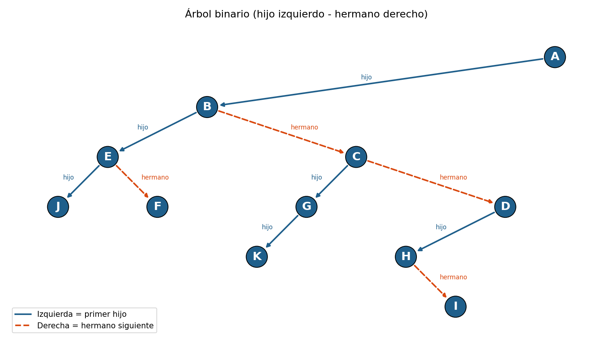
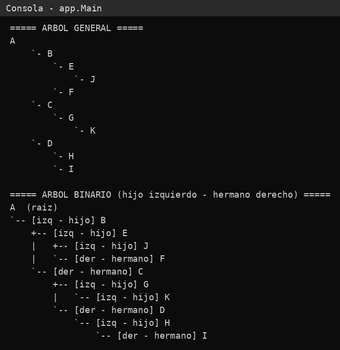

# RetoGrupo3-AndresLlamuca

Representación de una jerarquía de departamentos, equipos y trabajadores como **árbol general**, almacenada como **árbol binario** con la técnica **hijo izquierdo - hermano derecho**.

## Estructura del proyecto

```
RetoArbol/
├── README.md
├── docs/
│   ├── arbol_binario.png
│   └── captura_consola.png
└── src/
    ├── app/
    │   └── Main.java                    # Construye el árbol y lo muestra
    └── modelo/
        ├── ArbolOrganizacional.java     # Árbol: agregar(), buscar(), mostrar
        └── UnidadAcademica.java         # Nodo: hijoIzquierdo y hermanoDerecho
```

## Árbol general inicial

```
A
├── B
│   ├── E
│   │   └── J
│   └── F
├── C
│   └── G
│       └── K
└── D
    ├── H
    └── I
```

## Actividad 1: transformación a árbol binario



- **Izquierda (línea continua)**: primer hijo del nodo.
- **Derecha (línea punteada)**: siguiente hermano del nodo.

| Nodo | Hijo izquierdo | Hermano derecho |
|------|----------------|-----------------|
| A | B | - |
| B | E | C |
| C | G | D |
| D | H | - |
| E | J | F |
| F | - | - |
| G | K | - |
| H | - | I |
| I | - | - |
| J | - | - |
| K | - | - |

## Actividad 2: construcción por código

Solo se usa `arbolGeneral.agregar("Padre", nodoHijo)`, sin librerías de árboles ni listas. El orden de inserción importa: el padre debe existir antes que el hijo, y cada hijo se enlaza como último hermano.

```java
ArbolOrganizacional arbolGeneral = new ArbolOrganizacional("A");

arbolGeneral.agregar("A", new UnidadAcademica("B"));
arbolGeneral.agregar("A", new UnidadAcademica("C"));
arbolGeneral.agregar("A", new UnidadAcademica("D"));

arbolGeneral.agregar("B", new UnidadAcademica("E"));
arbolGeneral.agregar("B", new UnidadAcademica("F"));
arbolGeneral.agregar("C", new UnidadAcademica("G"));
arbolGeneral.agregar("D", new UnidadAcademica("H"));
arbolGeneral.agregar("D", new UnidadAcademica("I"));

arbolGeneral.agregar("E", new UnidadAcademica("J"));
arbolGeneral.agregar("G", new UnidadAcademica("K"));
```

## Actividad 3: resultado en consola



```
A  (raiz)
`-- [izq - hijo] B
    +-- [izq - hijo] E
    |   +-- [izq - hijo] J
    |   `-- [der - hermano] F
    `-- [der - hermano] C
        +-- [izq - hijo] G
        |   `-- [izq - hijo] K
        `-- [der - hermano] D
            `-- [izq - hijo] H
                `-- [der - hermano] I
```

## Cómo ejecutar

Desde la carpeta `RetoArbol`:

```bash
mkdir out
javac -d out src/modelo/*.java src/app/*.java
java -cp out app.Main
```

## Pregunta de análisis

**¿Por qué INFRAESTRUCTURA, DATOS y SOPORTE se representan como hermanos de DESARROLLO, aunque en el árbol binario aparezcan enlazados mediante referencias derechas?**

Porque en el árbol general todos tienen el mismo padre, y el árbol binario solo cambia la forma de guardarlos, no la relación entre ellos. En la técnica hijo izquierdo - hermano derecho, la referencia izquierda apunta al primer hijo del padre y la derecha apunta al siguiente hermano. El padre solo guarda a su primer hijo (DESARROLLO); los demás (INFRAESTRUCTURA, DATOS y SOPORTE) quedan enlazados en cadena por referencias derechas. Por eso la derecha no significa "descendiente", sino "hermano": todos están en el mismo nivel del árbol general. Con este método cada nodo necesita solo dos punteros, sin importar cuántos hijos tenga.

> En el ejemplo del reto, el mismo razonamiento aplica a B, C y D: B es el primer hijo de A y C y D son sus hermanos, enlazados por la derecha (B → C → D).
